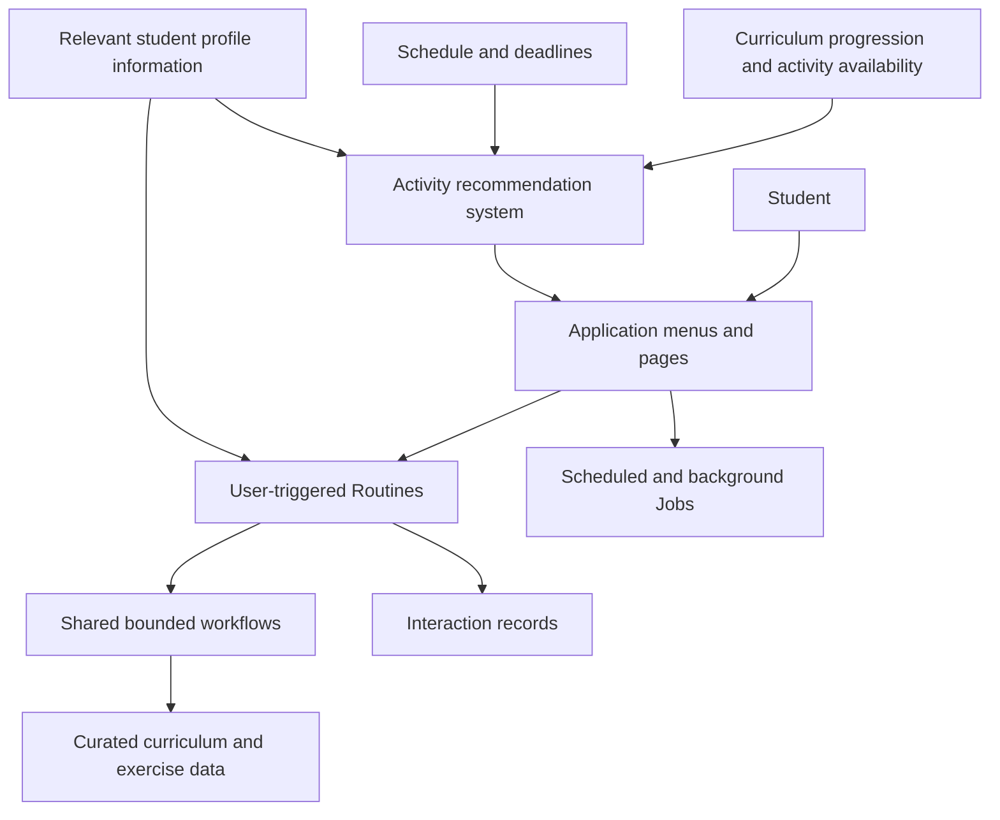
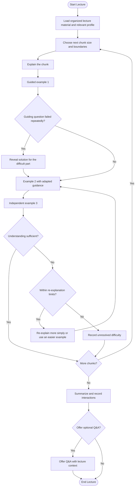
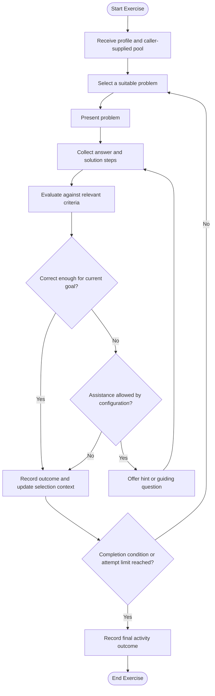
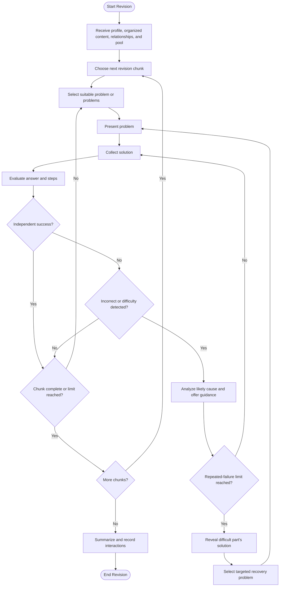
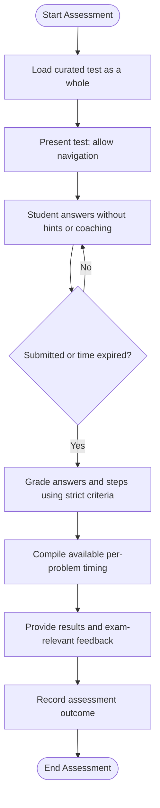
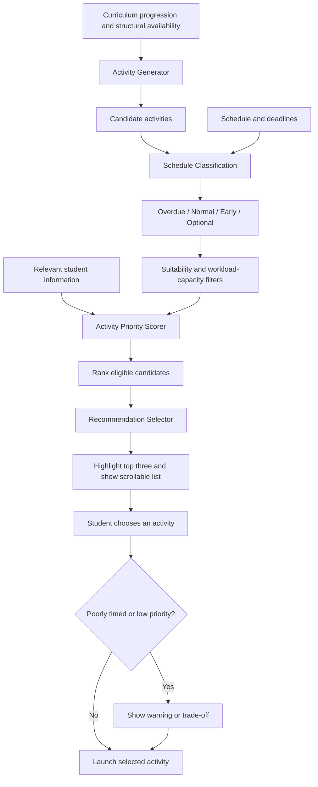

# AI-Powered Mathematics Learning Platform

## Project Context and Initial Design Decisions

**Purpose:** Introduce the project and record the design baseline agreed
so far for new collaborators.

**Initial scope:** Egyptian Preparatory Year 2 (Prep 2) mathematics.

**Status:** Working baseline. Provisional policies and open questions
are identified as such. This document intentionally excludes the
still-evolving student-profile implementation and
interaction-analysis/evidence-processing design.

------------------------------------------------------------------------

## 1. Project Overview

### 1.1 Goal

Build a structured learning platform that helps Prep 2 mathematics
students learn their curriculum and improve examination performance
efficiently. It is not a general-purpose chatbot: students use distinct
activities, menus, and workflows, such as Lecture, Exercise, Revision,
Assessment, and Diagnostic.

The platform should combine authoritative curriculum content, curated
teaching methodology, systematic practice across question types and
variations, exam-compatible written solutions, and personalization that
makes effective use of study time.

### 1.2 Initial scope and success criterion

The first release focuses on Prep 2 mathematics. The design should
permit future expansion without overengineering the initial version.

The main success criterion is improved ability to solve curriculum
questions and earn examination marks while using study time effectively.
Conceptual understanding is the default goal, but students must also
learn the expected range of question templates, variations, and edge
cases where this is necessary for exam readiness.

------------------------------------------------------------------------

## 2. Educational Principles and Content Policy

### 2.1 The official curriculum is authoritative

The platform must follow the official school curriculum. It must not
introduce mathematical facts, concepts, or techniques outside that
curriculum.

A mathematically valid alternative method may not match the method
expected in a school examination. Since written exams may award marks
for individual steps, the platform must respect the curriculum's
expected methods, written steps, conventions, official model answers,
and marking criteria.

### 2.2 Curated educational data

The current source is an official scanned schoolbook PDF with OCR
errors. The intended approach is to convert it into structured,
quality-controlled Markdown curriculum data rather than relying on
direct PDF parsing or simple retrieval over the raw document.

OCR corrections must be verified against the source. Curriculum material
and curated explanations should remain traceable to their sources.

### 2.3 Three educational content layers

1.  **Official curriculum reference:** Definitions, facts, rules,
    formulas, worked examples, and other authoritative content,
    structured according to the curriculum hierarchy.
2.  **Curated teaching methodology:** Explanations, sequencing,
    scaffolding, guiding questions, and pedagogical material designed to
    improve learning per unit of study time. This layer must not
    introduce out-of-curriculum mathematics or techniques.
3.  **Exam intelligence:** Past examination questions, official model
    answers, marking criteria, question patterns, common variations, and
    relevant edge cases.

These layers have distinct purposes. Teaching methodology can improve
how official content is taught but cannot override the curriculum.

### 2.4 Curriculum hierarchy

A typical structure is `Chapter → Headers/Sections → Points`. A
**point** is the smallest atomic unit. Larger units can be assembled
from points and sections for teaching, revision, and other activities.

The size of a unit presented to a student may vary by activity and
student needs.

------------------------------------------------------------------------

## 3. Product and Architecture Principles
### At a glance: application structure



This is a conceptual overview, not a final deployment diagram. Student-profile internals and interaction-analysis mechanisms are intentionally left unspecified.


### 3.1 Routines and Jobs

The product consists of distinct user-facing activities, not one
open-ended chat.

-   **Routine:** A continuous, user-triggered activity with a defined
    workflow and lifecycle. Examples: Lecture, Exercise, Revision,
    Assessment, and Diagnostic.
-   **Job:** A scheduled or background task that runs independently of a
    student actively using a routine.

A routine starts from a user action. Its first interaction may be an
application message or a response to the student's own message,
depending on the routine. It ends according to explicit conditions such
as completion, submission, timeout, or a configured limit.

Routines may reuse shared sub-workflows. An optional open-ended Q&A
activity may be offered at the end of a routine, except when the student
already chose Q&A as the activity.

### 3.2 Explicit, bounded workflows

Routines should use explicit workflow chains with defined transitions
and responsibilities. Unconstrained autonomous flow control is not the
intended architecture.

This supports predictable behavior, testability, cost control, clear
responsibility boundaries, and reliable termination and recovery.
Decision-making may combine deterministic rules with bounded
probabilistic inference, but the surrounding workflow remains
orchestrated and controlled.

### 3.3 Implementation direction

The current direction is a **Python modular monolith**:

-   Modules have explicit responsibilities and interfaces.
-   Related code stays together until there is a demonstrated reason to
    separate it.
-   Avoid premature microservices.
-   Reuse genuinely shared workflows.
-   Keep persistence and workflow boundaries explicit.

This is a direction, not a finalized package layout or database schema.

### 3.4 Activity records

Routines should produce records of what occurred during the activity.
The detailed design of student profiles, analysis pipelines, and
evidence processing is intentionally excluded from this document.

------------------------------------------------------------------------

## 4. Lecture Routine
### Lecture flow



The diagram shows the default three-example sequence. Exact retry and stopping limits remain configurable.


### 4.1 Purpose, inputs, and output

Lecture teaches selected curriculum content through explanations and
examples, adapting chunk size and support to the student's needs.

**Inputs:** The complete hierarchically organized lecture material for
the selected scope, plus relevant student profile information.

**Output:** Records of the student's interactions with the lecture and
its examples.

### 4.2 Chunk selection

The routine chooses a chunk size appropriate to the student. A chunk may
be one point, one section/header, multiple sections, or a larger unit
such as a chapter.

The routine receives the whole organized lecture material so that it can
select appropriate boundaries. Initial chunk granularity should remain
consistent during a run unless sufficient evidence indicates that it
should change; it should not be reassessed after every small
fluctuation.

### 4.3 Teaching and examples

For each chunk:

1.  Explain the relevant content.
2.  Present a first example using guiding questions by default.
3.  If the student repeatedly fails a guiding question, reveal the
    solution for that specific part according to the configured
    threshold. The initial default is two failures.
4.  Present a second example with support adapted to difficulties
    observed in the first.
5.  Present a final example for independent solving.

The MVP defaults to **three examples per chunk**. The number may become
configurable or adaptive later, but advanced adaptation is not required
initially. The first example should not automatically be solved in full.
If a student struggles with a specific step, the routine can demonstrate
that step and provide an opportunity to practise it in the next example.

### 4.4 Insufficient understanding and completion

If the student continues to struggle, the routine may re-explain the
idea more simply, use an easier example, or adjust the guidance. It must
not loop indefinitely: it can finish with unresolved difficulties
recorded.

Students who need extensive practice should be directed toward suitable
Exercise activities, which can cover question types more broadly.

At the end, the routine summarizes the lesson, records interactions, and
may offer an optional Q&A activity seeded with lecture context. The
routine can end even if some difficulties remain unresolved.

------------------------------------------------------------------------

## 5. Exercise Routine
### Exercise flow



The caller supplies the exercise pool. The routine must stop before exhausting it: the maximum number of attempts is strictly less than the pool size. Retention Training uses this same flow with different parameters.


### 5.1 Purpose, inputs, and output

Exercise develops the student's ability to solve a supplied set of
problems, adapting practice based on performance.

**Inputs:** Relevant student profile information and an exercise pool
supplied by the caller. The routine does not choose the overall topic
scope or pool; this allows both single-topic and mixed-topic practice.

**Output:** Records of presented problems, answers and solution steps,
assistance, and outcomes.

### 5.2 Exercise metadata

For the MVP, exercises need lightweight metadata, including curriculum
points covered, relevant skills or estimated skill requirements, and
tags needed for selection and classification. Advanced per-exercise
profiling is not required initially.

### 5.3 Practice flow and limits

The routine selects an appropriate problem from the supplied pool,
presents it, evaluates the answer and solution steps against relevant
criteria, and adapts subsequent selection. When the student struggles,
it may provide guiding questions or hints and adjust later problems.

The long-term goal is competence across relevant problem types,
variations, and edge cases.

The routine must **not exhaust the supplied pool**. Its maximum number
of attempts must be strictly less than the pool size, preserving
problems for future practice. The routine ends when its completion or
stopping conditions are reached, including its attempt limit.

### 5.4 Retention Training as a configuration

Retention Training is **not a separate core routine**. It is Exercise
configured with an older-topic pool and different parameters. For
example, hints and guiding questions can be delayed until the student
has failed several times, encouraging unaided recall before assistance.

------------------------------------------------------------------------

## 6. Revision Routine
### Revision flow



Assisted success does not count as independent success. Revision continues through the selected scope even if some difficulties remain unresolved, subject to configured limits.


### 6.1 Purpose, inputs, and output

Revision revisits selected previously studied content, combines concise
teaching with targeted practice, and helps the student recover and
reinforce knowledge.

**Inputs:** Relevant student profile information, organized revision
content with chunk boundaries and relationships, and a preselected
exercise pool. The caller chooses the revision scope.

**Output:** Records of content covered, problems attempted, assistance,
student responses, and outcomes.

### 6.2 Revision flow

Revision uses personalized chunk sizes as in Lecture, but places greater
emphasis on practice and recovery.

For each chunk:

1.  Select suitable problems from the supplied pool using relevant
    student information and performance during the current activity.
2.  Vary problem count and difficulty according to need.
3.  Evaluate the answer and solution steps.
4.  If the answer is wrong, investigate plausible causes and offer hints
    or guiding questions.
5.  If failure continues beyond the configured limit, reveal the
    solution to the specific difficult part and continue with the same
    problem where practical.
6.  Provide recovery practice targeting the concepts that caused
    difficulty.

### 6.3 Recovery and completion

Recovery should target the actual difficulty. If several concepts caused
trouble, prefer one suitable problem that tests them together; otherwise
split them across problems.

An assisted success does **not** count as an independent success for
chunk completion. The goal is at least one independent solution per
chunk, or reaching a configured limit.

Minor calculation mistakes may sometimes be tolerated when deciding
whether the underlying concept is understood, but feedback and exam
marking must still identify the mistake. Tolerance must not silently
turn an incorrect exam answer into a fully correct one.

Revision continues through the selected scope despite unresolved
difficulties. Closely related concepts and prerequisites may receive
tighter practice budgets, guided by the supplied content relationships.

------------------------------------------------------------------------

## 7. Assessment Routine
### Assessment flow



The test is not adaptively altered. Exam Simulation uses this same routine with special parameters.


### 7.1 Purpose, inputs, and output

Assessment evaluates performance under exam-like conditions rather than
teaching or coaching during the test.

**Input:** A curated test supplied as a whole.

**Output:** Responses, marks, timing information, completion status, and
end-of-assessment feedback.

### 7.2 Test presentation and strict behavior

The whole test is presented, remains navigable, and is not altered
through adaptive question selection. Assessment does not draw
replacement questions from a dynamic exercise pool.

During the test, the routine must not provide solution-revealing
teaching, hints, guiding questions, coaching retries, or adaptive
replacement of questions.

Answers and solution steps are graded using strict marking criteria,
preserving partial-credit distinctions and identifying incorrect or
missing steps.

### 7.3 Timing, completion, and feedback

The assessment ends when the student submits or the configured time
limit expires. Record per-problem timing where measurable, including
response time and idle time.

After the assessment, grade the work and provide feedback about
performance, simple mistakes, and possible issues. Do not relax awarded
marks merely to make feedback encouraging.

### 7.4 Exam Simulation and reassessment

**Exam Simulation is Assessment called with special parameters**, not a
separate core routine.

Previous assessment does not permanently disqualify a student from
taking another one; reassessment can be requested on demand. A proactive
assessment recommendation roughly one week after a lesson has been
discussed, but the scheduling policy is not finalized.

------------------------------------------------------------------------

## 8. Diagnostic Routine
### Diagnostic traversal concept

```mermaid
flowchart TD
    Start([Start Diagnostic]) --> Init[Initialize x = 1, c = 0, n = topic count]
    Init --> Choose[Choose topic f(x) = min(x² + c, n)]
    Choose --> Ask[Ask diagnostic question or questions]
    Ask --> Result{Topic test result}
    Result -- Pass / continue search --> Advance[Advance traversal position]
    Result -- Fail --> Narrow[Set c = f(x - 1); n = f(x) - 1; reset x = 1]
    Advance --> Terminate{Budget exhausted or terminal condition?}
    Narrow --> Terminate
    Terminate -- No --> Choose
    Terminate -- Yes --> Finish[Record tested boundary; leave untested topics unknown]
    Finish --> End([End Diagnostic])
```

This diagram illustrates the intended search behavior, not a verified algorithm implementation. The traversal formula, indexing, and boundary cases must be tested before coding.


### 8.1 Purpose

Diagnostic efficiently searches for the student's current position in
the curriculum. It is not intended to comprehensively measure mastery or
proficiency. A diagnostic response alone should not be treated as proof
of durable mastery or a persistent weakness.

### 8.2 Proposed traversal

The current proposal uses a quadratic progression rather than sequential
traversal or a simple binary search:

\[ f(x)=`\min`{=tex}(x\^2+c,n) \]

Initially, (x=1), (c=0), and (n) is the total number of topics in scope.
The function identifies the next topic to test.

On failure at topic (f(x)):

1.  Set (c=f(x-1)).
2.  Set (n=f(x)-1).
3.  Reset (x=1).
4.  Continue with the updated bounds.

The intention is to narrow the search without revisiting tested topics.
Traversal ends when (f(x)=f(x-1)) or the diagnostic budget is exhausted.
Untested topics remain unknown; they are not treated as passed or
failed. More than one question may be asked per topic.

### 8.3 Validation required

The formula above records the current design proposal. Indexing
conventions, boundary cases, question selection, and the behavior for
different topic counts must be verified before implementation.

Diagnostic results primarily establish curriculum position. Any future
use of diagnostic responses for other purposes must preserve their
preliminary nature and distinguish them from evidence obtained through
targeted repeated practice.

------------------------------------------------------------------------

## 9. Activity Recommendation System
### Recommendation pipeline



The pipeline recommends activities but does not prevent students from launching other activities through the application menus.


### 9.1 Purpose and stages

The system recommends useful next activities based on curriculum
progression, schedule, student needs, and expected value. It should
guide students without preventing them from choosing activities
themselves.

The design separates four responsibilities:

1.  **Activity Generator:** Generates candidates based primarily on
    curriculum progression and structural availability.
2.  **Schedule Classification and Filtering:** Classifies candidates by
    timing and necessity, then filters candidates that should not
    currently be recommended.
3.  **Activity Priority Scorer:** Estimates relative priority.
4.  **Recommendation Selector:** Ranks candidates and prepares the
    displayed list.

These are logical components, not necessarily separate services.

### 9.2 Activity generation

The generator creates activities structurally available given curriculum
progression. The MVP can use straightforward deterministic rules rather
than complex optimization.

For example, after Lesson 1 is studied, candidates might include Lecture
Lesson 2, Exercise Lesson 1, Revision Lesson 1, Assessment Lesson 1, and
eligible Retention Training. The exact candidates depend on curriculum
dependencies, completion status, and activity-specific suitability.

### 9.3 Schedule categories

Candidates are classified into four categories:

-   **Overdue:** Intended timing or deadline has passed.
-   **Normal:** Appropriate for the current progression or schedule.
-   **Early:** Available but ordinarily better postponed.
-   **Optional:** Available but not currently necessary under the
    applicable policy.

Timing and optionality are separate considerations. Optionality
expresses necessity; schedule timing expresses whether an activity is
early, normal, or overdue. Their exact interaction should be defined
consistently during implementation.

### 9.4 Initial suitability rules

These are initial rules and proposals, not a complete scheduling policy.

**Assessment** - In the MVP, proactive assessment candidates cover
exactly one completed lesson at a time. - A lesson already assessed may
make another proactive assessment for that lesson Optional. -
Reassessment remains available on demand. - Assessing Lesson 1 must not
make assessment of Lesson 2 unsuitable. - A recommendation roughly one
week after a lesson is a possible policy, not a finalized rule.

**Retention Training** - Consider older material whose retention has not
been shown to be sufficiently good. - Initial proposal: a period (p=2)
weeks and a minimum eligible content quantity (n=3). - Exclude material
with sufficiently recent evidence of good retention. - If enough
eligible content remains, Retention Training may be generated. - The
quantity should eventually measure meaningful content, not necessarily
whole lessons. The initial values can be revisited.

**Revision** - A content unit may be suitable for revision when its
latest visit was more than period (p) ago. - Later refinements may
distinguish merely opening content from meaningfully studying it.

### 9.5 Priority scoring

The scorer may consider:

-   **Performance Impact (P(a)):** Expected contribution of activity (a)
    to educational or examination performance.
-   **Overdue Score (O(a)):** Priority due to overdue status.
-   **Deadline urgency:** How urgently an activity should be completed
    before its relevant deadline.
-   **Feasibility:** Whether it can reasonably be completed in the
    available time.
-   **Duration:** Expected time required.

The final equation, normalization, and weights are not finalized.

Urgency should rise nonlinearly as a relevant deadline approaches. It
should not prioritize an activity solely because it is long, nor ignore
urgency simply because its estimated duration is currently less than the
remaining time.

Let (T(a)) be estimated activity duration and (R(a)) the time remaining
until its relevant deadline. A possible approach combines base priority
with an urgency contribution rather than allowing duration to dominate.
This is illustrative, not finalized.

When priorities are comparable, a shorter activity may be preferred as a
tie-breaker. Feasibility remains distinct from urgency: an activity may
be urgent but too long to complete before an exam. The system may need
to split it, warn the student, or recommend a feasible alternative.

### 9.6 Workload-capacity filter (provisional)

The current proposal attempts to determine whether there is enough
expected study capacity to include Early and Optional activities in
addition to Overdue and Normal activities.

Define: - (D): Overdue ∪ Normal activities. - (N): Normal activities. -
(T(a)): Estimated duration of activity (a). - (R(a)): Time remaining
until its relevant deadline. - (A(s)`\in[0,1]`{=tex}): Estimated
fraction of available time that the student actively uses the
application.

Required workload:

\[ W=`\sum`{=tex}\_{a`\in `{=tex}D}T(a) \]

Rough capacity estimate:

\[
C=A(s)`\times`{=tex}`\operatorname{average}`{=tex}\_{a`\in `{=tex}N}R(a)
\]

If (N) is empty, skip the filter.

The initial rule excludes Early and Optional activities when (W\<C) is
false; when (W\<C) is true, they may remain eligible for subsequent
ranking. The inequality is intentionally strict.

This is only an approximation. Comparing workload to average remaining
time does not precisely model multiple deadlines and does not explicitly
add Early and Optional activity durations. Implementation should
preserve the intended policy---include early/optional work only when
capacity appears sufficient---while validating or refining the formula.

### 9.7 Selection and display

After classification, filtering, and scoring:

-   Rank remaining candidates.
-   Highlight the top three.
-   Display a scrollable list of other eligible recommendations.
-   Hide activities below a configurable recommendation threshold.

Students may still start activities manually through the application
menus, even when an activity is not recommended. If the choice is poorly
timed---for example, a long revision activity shortly before an
exam---the application may show a warning or explain the trade-off.
Recommendations should guide, not unnecessarily restrict, student
autonomy.

Retain enough information about scoring and filtering decisions to
support understandable explanations and warnings.

------------------------------------------------------------------------

## 10. Cross-Routine Principles

### 10.1 Reuse without erasing differences

Reuse genuinely common workflows, such as problem presentation, answer
collection, marking, bounded assistance, interaction recording, and
stopping conditions.

However, shared code must preserve meaningful differences between
routines. In particular, Assessment must remain non-instructional and
non-adaptive while a test is in progress.

### 10.2 Bounded adaptation

Teaching, Exercise, and Revision may adapt to performance, but each
needs explicit limits and completion conditions. Avoid unbounded loops,
repeated assistance with no stopping policy, and runs that consume all
available content.

### 10.3 Exam-compatible evaluation

For written-exam preparation, distinguish mathematical correctness,
individual-step correctness, solution completeness, and compatibility
with the expected curriculum method and answer format. These dimensions
overlap but are not interchangeable.

### 10.4 Routine summary

  -----------------------------------------------------------------------
  Routine                 Primary purpose         Adaptive teaching
                                                  during activity?
  ----------------------- ----------------------- -----------------------
  Lecture                 Teach curriculum        Yes
                          content through         
                          explanations and        
                          examples                

  Exercise                Practise problems from  Yes
                          a supplied pool         

  Revision                Reinforce selected      Yes
                          older content and       
                          recover difficulties    

  Assessment              Evaluate performance    No, not during the test
                          under exam-like         
                          conditions              

  Diagnostic              Efficiently locate the  Limited to diagnostic
                          student's position in   traversal and testing
                          the curriculum          
  -----------------------------------------------------------------------

Retention Training reuses Exercise with different parameters. Exam
Simulation reuses Assessment with different parameters.

------------------------------------------------------------------------

## 11. Intentionally Out of Scope

The following areas remain under active design and are not specified
here:

-   Student profile's internal model, storage, and access interfaces.
-   Detailed interaction evidence and analysis design.
-   How observations become long-term student estimates.
-   Evolving student hypotheses or investigation-card representation.
-   Retrieval and context-compression policies for interaction analysis.
-   Complete scheduling/job system and finalized assessment timing.
-   Final recommendation-scoring equations and calibrated thresholds.
-   Production database schema, package layout, deployment topology, and
    operational infrastructure.

These areas should be designed in focused discussions. This document
does not implicitly decide them.

------------------------------------------------------------------------

## 12. Open Questions and Validation Work

1.  **Curriculum data:** Finalize the Markdown schema, source
    traceability, review process, and OCR correction workflow.
2.  **Routine limits:** Specify retry, guidance, attempt, timeout, and
    termination defaults.
3.  **Diagnostic algorithm:** Verify the traversal formula, indexing,
    and boundary cases across topic counts.
4.  **Exercise selection:** Define initial selection rules that preserve
    the supplied pool.
5.  **Revision budgets:** Specify limits for repeated failure,
    assistance, recovery problems, and chunk completion.
6.  **Assessment scheduling:** Finalize proactive recommendation timing
    and optionality.
7.  **Recommendation scoring:** Choose an urgency function,
    normalization, tie-breaking, and recommendation threshold.
8.  **Capacity filtering:** Validate behavior across multiple deadlines
    and the intended handling of Early and Optional activities.
9.  **Testing:** Create scenario-based tests for normal paths, repeated
    failures, timeouts, interruptions, empty or insufficient pools, and
    recovery.
10. **Profile and interaction analysis:** Continue separately; do not
    infer their implementation from this document.

------------------------------------------------------------------------

## 13. Suggested Next Steps

1.  Finalize the curriculum data schema and prepare a small, verified
    slice of the Prep 2 textbook.
2.  Write routine contracts specifying inputs, outputs, states,
    transitions, limits, and termination conditions.
3.  Draw and validate state diagrams, including failure, timeout, and
    interruption paths.
4.  Specify exercise-pool and problem-metadata formats shared by
    Exercise, Revision, and parts of Lecture.
5.  Convert recommendation policies into testable rules, keeping
    unfinalized equations clearly provisional.
6.  Implement a narrow vertical slice using one curriculum chunk and a
    small curated exercise pool, then validate the workflow before
    expanding.

The immediate priority is to make curriculum data and routine contracts
precise enough that implementation does not silently invent educational
behavior.
